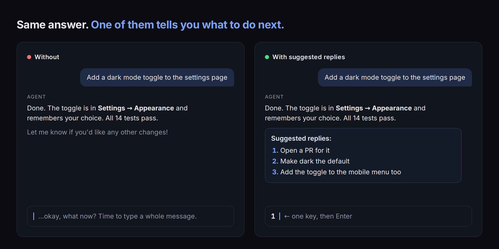
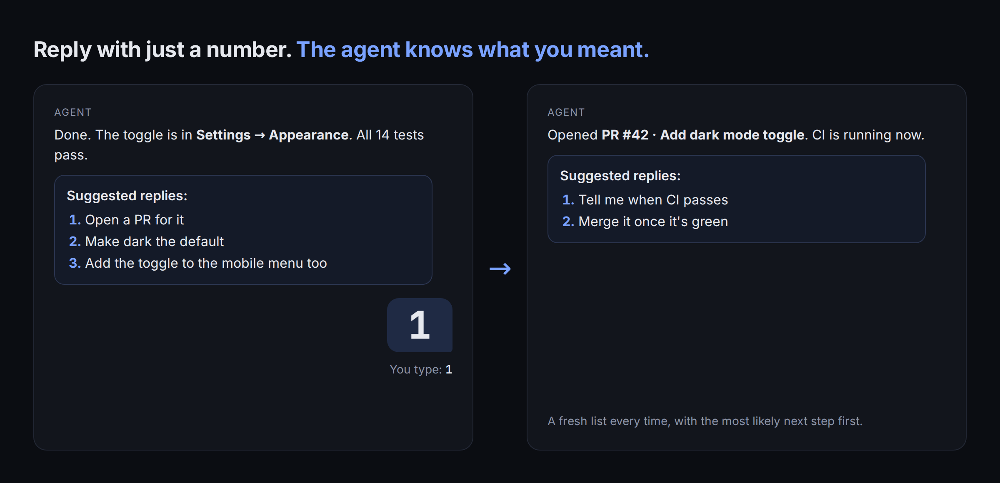
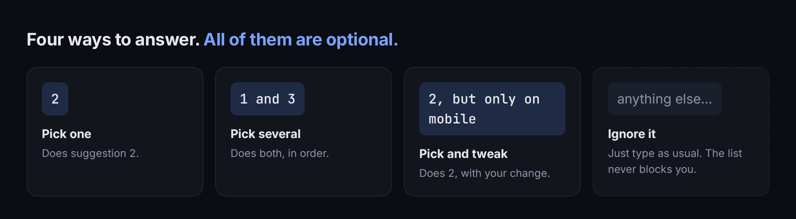

# Suggested replies

**Your coding agent ends every reply with two or three numbered next steps. Type `1` to do the first one.**

Works in [T3 Code](https://github.com/pingdotgg/t3code), Claude Code and Codex: anywhere plain text shows up.
No plugin, no server, no dependencies. It is one short block of instructions.



## Install: tell your agent

Paste this into Claude Code or Codex:

```text
Install https://github.com/s0673468/suggested-replies for me. Follow its INSTALL.md.
```

Or do it yourself:

```bash
git clone https://github.com/s0673468/suggested-replies
suggested-replies/install.sh
```

Then start a new chat. Agents read their instructions when a session starts.

## How you use it





## Why

The Claude and Codex apps can show reply suggestions as buttons. T3 Code doesn't
(as of 0.1.7, it leaves the Claude Agent SDK's prompt suggestions off and shows
Codex follow-up tags as plain text). A plain-text list works in every interface,
including terminals and phones. It also gives you two or three choices instead of one guess.

## The rules, and why each one is there

These came from two days of real use (138 suggestion lists).

| Rule | Why |
| --- | --- |
| Most likely next step first | People picked `1` in four of six number-only replies. |
| Refresh the list, don't repeat it | In long threads, 28% of lists were copies of the previous one, which is just noise. |
| Offers, not questions or approval requests | The agent keeps working. The list never blocks you. |
| Never suggest work the reply already did | A suggestion should move you forward. |
| `1 and 3`, `2, but …` | You can pick several, or pick one and change it, without typing it all out. |
| Skip it for one-line status updates and agent-to-agent messages | A list there is clutter, and another agent can't "pick 2". |

The full text is in [`snippet.md`](snippet.md). Edit it if you want different rules.

## Files

| File | What it is |
| --- | --- |
| [`snippet.md`](snippet.md) | The instruction block itself |
| [`INSTALL.md`](INSTALL.md) | Step-by-step instructions written for your agent |
| [`install.sh`](install.sh) | Adds, updates or removes the block for Claude Code and Codex |

## Uninstall

`suggested-replies/install.sh --uninstall`, or ask your agent to remove the
`suggested-replies` block. Only the text between its markers is touched.

## License

MIT
